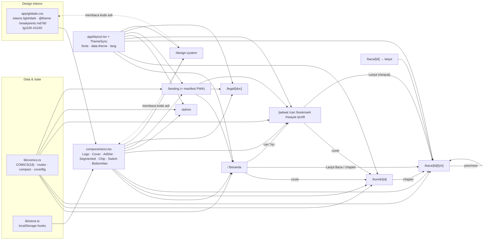

# nacp — knowledge graph

Satu sistem. Tiap node = route/file; tiap garis = dependensi data atau desain yang nyata. Update file ini kalau nambah route, key storage, atau komponen bersama.

## State lintas halaman (localStorage)

| Key | Hook | Ditulis oleh | Dibaca oleh |
|---|---|---|---|
| `nacp-theme` | `useTheme` | toggle di semua header, admin, DS | layout (no-flash), ThemeSync, reader bg `auto` |
| `nacp-lang` | `useLang` | `LangToggle` | semua halaman publik |
| `nacp-premium` | `usePremium` / `useAdsOn` | /profil (bayar), logout | semua `AdSlot`, tombol "Bebas iklan" beranda |
| `nacp-logged` | `useLogged` | /profil | header avatar halaman |
| `nacp-bm` | `useBookmarks` | /komik, /jadwal, /bookmark | /bookmark, /komik, /profil |
| `nacp-progress` | `useProgress` | reader | beranda Lanjut Baca, /komik, /bookmark, /baca/[id] |
| `nacp-hist` | `useHistory` | reader | /riwayat |
| `nacp-reader-v2` | `useStored` | panel pengaturan reader | reader |
| `nacp-notif`, `nacp-prefs` | `useStored` | /bookmark, /profil | sama |

## Aturan yang dipegang

- Semua warna lewat token; tema = `data-theme` di `<html>`.
- Cover selalu 3:4 (`Cover`), min 150px mobile / 190px desktop.
- Slot iklan tinggi tetap; premium → `AdSlot` return null (script iklan tidak dimuat).
- Data komik hanya dari `lib/comics.ts`; admin data mock di `app/admin/data.ts`.

## Belum ada (sengaja, bukan bagian desain)

- Backend/API: auth, pembayaran, upload ke CDN, ad manager tersimpan. Semua masih mock/client state.
- Warna aksen dari Admin > Tampilan baru berlaku di preview admin, belum ke situs.
- Gambar asli: cover/halaman masih placeholder → ganti `Cover` ke `next/image` saat CDN siap.
